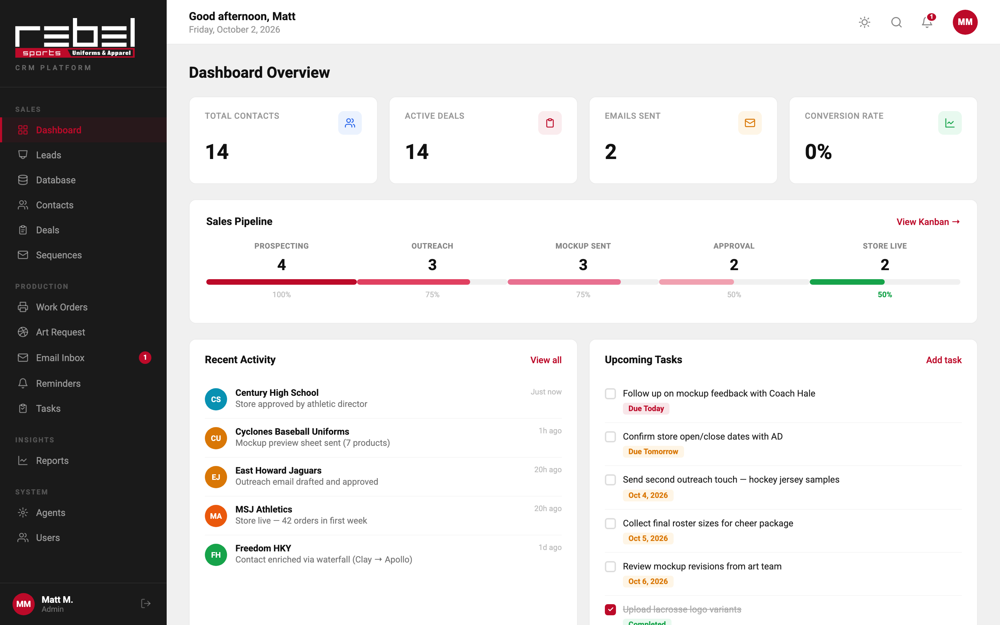
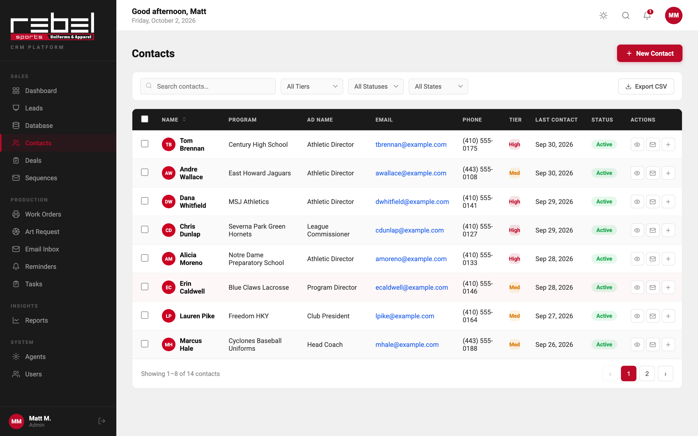
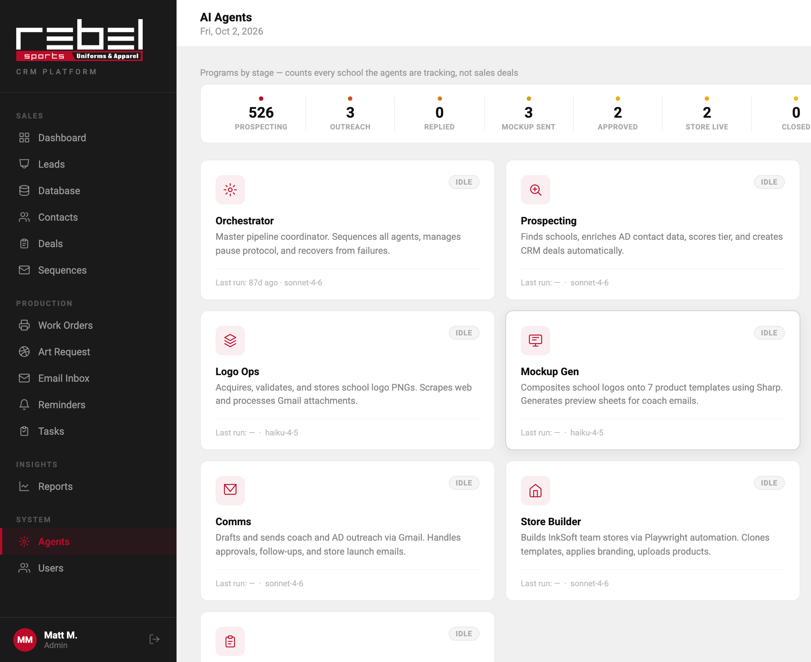
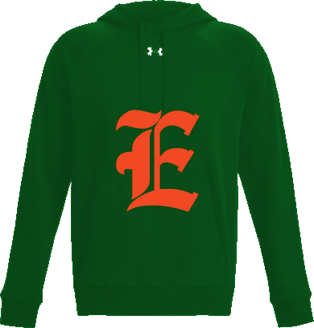
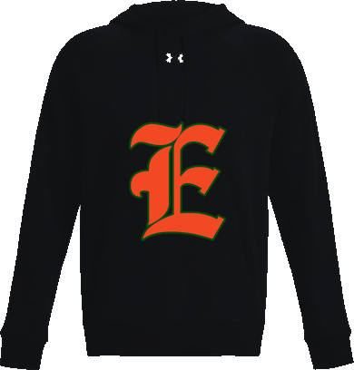
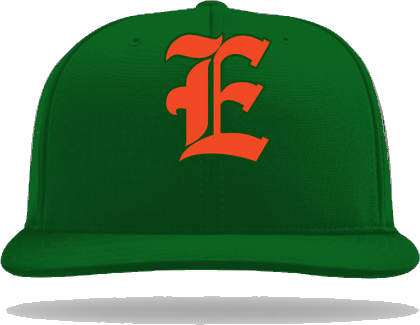
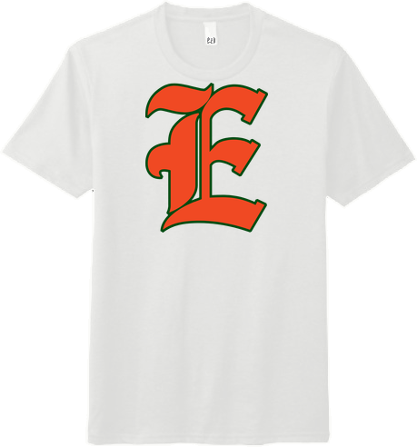
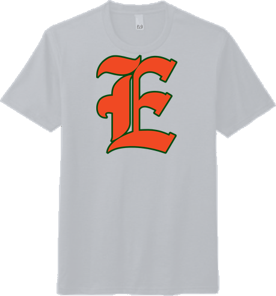
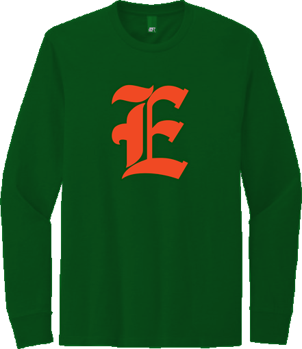
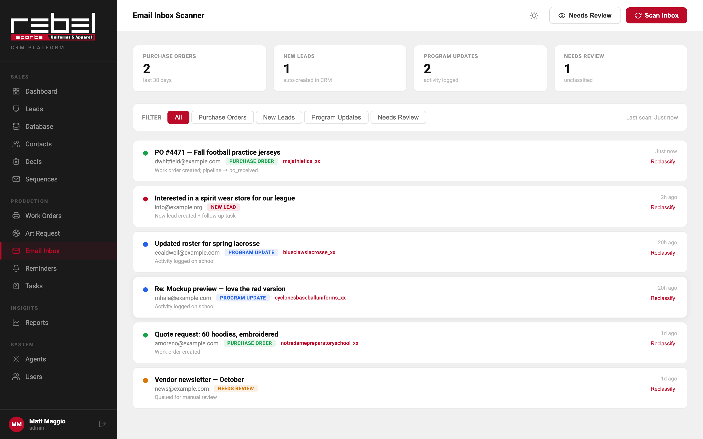

# Team store automation

> A case study, not a code repo. The source is private because it runs a client's
> business. I'm glad to walk through it in an interview.

Rebel Sports is a custom uniform and spirit wear company in Hanover, Maryland. They sell
team stores: branded storefronts where a school's athletes order their own gear, hosted on
InkSoft. I built the system that runs that business from end to end, starting at finding a
school worth pitching and finishing at the print files that go to the manufacturer.

Solo build, about four months, with Claude Code as the implementation loop.

## What it replaced

Every team store used to be assembled by hand:

1. Find a school worth pitching, then hunt down the athletic director's email.
2. Track down the school's logo and clean it up.
3. Composite that logo onto seven blank garment templates in Photoshop so the coach has
   mockups to look at.
4. Build the InkSoft storefront by hand: clone a template, recolor the tabs to school
   colors, upload each product.
5. Once the store closed, pull the orders, group them, resize the art for every garment
   size, and type up a purchase order for the manufacturer.
6. Track production in Monday.com, which knew nothing about any of the above.
7. Read the CEO's Outlook inbox by eye to find the purchase orders and the new leads.

Each of those is now either automated outright or reduced to an approve-or-reject click,
with one system of record behind all of it.

## What it does now

Three layers live in one repo.

### A CRM as the system of record

Node and Express on SQLite, with JWT auth and bcrypt hashing. Role checks run server-side
in middleware rather than being hidden in the interface, across three roles: admin, sales
rep, and art team. The schema is 16 tables covering schools, contacts, deals, work orders,
InkSoft stores, gate approvals, agent runs, and an activity log.

The front end is plain HTML, CSS and JavaScript with no build step. That was deliberate.
The client needs to run this on a LAN server without a toolchain, so there is nothing to
compile and no CDN to depend on.

### Nine agents that run the sales cycle

Worth being precise about what these are, because "nine AI agents" invites a fair
question. Each agent is a long-form Markdown runbook that the Claude Code CLI executes.
They are not autonomous services sitting in a process somewhere. An orchestrator sequences
them, checks each stage's output before handing off, and writes to an append-only run log.

| Agent | What it does | Model |
|---|---|---|
| orchestrator | Sequences stages, validates handoffs, owns the run log | Sonnet |
| prospecting | Finds schools, enriches contacts, scores tier, opens a deal | Sonnet |
| social-scraper | Finds rec and club programs from their social presence | Sonnet |
| logo-ops | Collects and validates school logo assets | Haiku |
| mockup-gen | Composites logos onto garment blanks with Sharp | Haiku |
| comms | Drafts coach and AD email, watches for replies | Sonnet |
| store-builder | Builds the InkSoft storefront via Playwright | Sonnet |
| order-collection | Pulls closed-store orders, builds the manufacturer PO | Haiku |
| email-scanner | Classifies the CEO's inbox | Sonnet, classify step on Haiku |

Model choice per agent is a cost decision. Haiku handles deterministic file and image
work. Sonnet handles judgment and anything that can send an email or publish a store, and
the store builder never runs on Haiku because the stakes are too high. The email scanner
stays on Sonnet while delegating its high-volume per-message classification down to Haiku.

Approval gates were the hard part. Agents run headless, so a gate cannot be a prompt
waiting on a terminal. Instead the agent writes a durable approval record and exits. An
admin approves in the web interface, and that approval spawns a resume run. No customer
email goes out and no storefront gets published without a recorded human sign-off.

### Deterministic scripts for the work that shouldn't be a model's job

33 Node scripts handle everything that needs to be exact. The order poller watches the
InkSoft API and opens a work order when an order lands. The DTF renderer resizes print art
into six garment size buckets with Sharp. The history backfill walks the full order
history with checkpointing so it can resume after a failure. A Playwright sweep loads
every CRM page and reports console errors and bad responses.

The backfill was the one that changed the conversation with the client. It reconstructed
542 storefronts and $4.09M in lifetime order history into a queryable database they had
never had.

### Mockups

The mockup generator composites a school's logo onto garment templates and builds a
preview sheet for the coach. These are real output:

| | | |
|---|---|---|
|  |  |  |
|  |  |  |

One logo, one run, seven garment templates. The coach gets a preview sheet instead of
waiting on a Photoshop session.

### Inbox triage

The email scanner reads the CEO's Outlook inbox over Microsoft Graph and sorts what lands
there into purchase orders, new leads, program updates, and everything else. A purchase
order opens a work order on its own. A new lead becomes a CRM record with a follow-up task
attached.

## Where it actually stands

| Part | Status |
|---|---|
| Order poller and DTF print workflow | Running on real customer orders |
| Order history backfill | Done and verified |
| CRM | Built and operated locally. Not yet on the client's server |
| Work orders board | Built and verified. Monday.com cutover not yet scheduled |
| Approval gates | Built. Verified against a stubbed CLI, not a full headless run |
| Store builder | Complete, but only ever run in dry run. Has never published a live store |
| Email scanner | Code complete. Blocked on the client's Azure AD credentials |
| Printer hotfolder | Built behind a disabled flag, pending printer details |
| Docker and Windows deploy | Written and verified on a Mac. Never installed on client hardware |

The order-to-print path is the part that runs on live orders today. The rest is built and
waiting on credentials or hardware from the client side rather than on more code.

## Built to be handed over

The client's own staff operate this after cutover, which shaped most of the decisions. The
repo ships with Docker and native Windows deploy runbooks, a credential checklist naming
who inside the client organisation owns each secret, automated backups, and an Azure AD
setup guide written for a non-technical IT admin. A preflight credential check blocks any
agent run when configuration is missing, so a half-configured install fails loudly instead
of halfway through a customer email.

## Stack

Node, Express 5, SQLite via better-sqlite3, JWT with bcrypt, Playwright, Sharp, Docker.
Seven external systems: InkSoft, Microsoft Graph, Gmail, Apollo.io, Clay, Vibe
Prospecting, and the Anthropic API. The InkSoft client runs dual-path, falling back from
an OAuth connector to a direct REST key when it needs to work in a headless server
context.

The Cloudflare Worker that handles InkSoft writes has 19 test files behind it, a
dry-run-by-default writer, and an allowlist that refuses any store not explicitly named.
